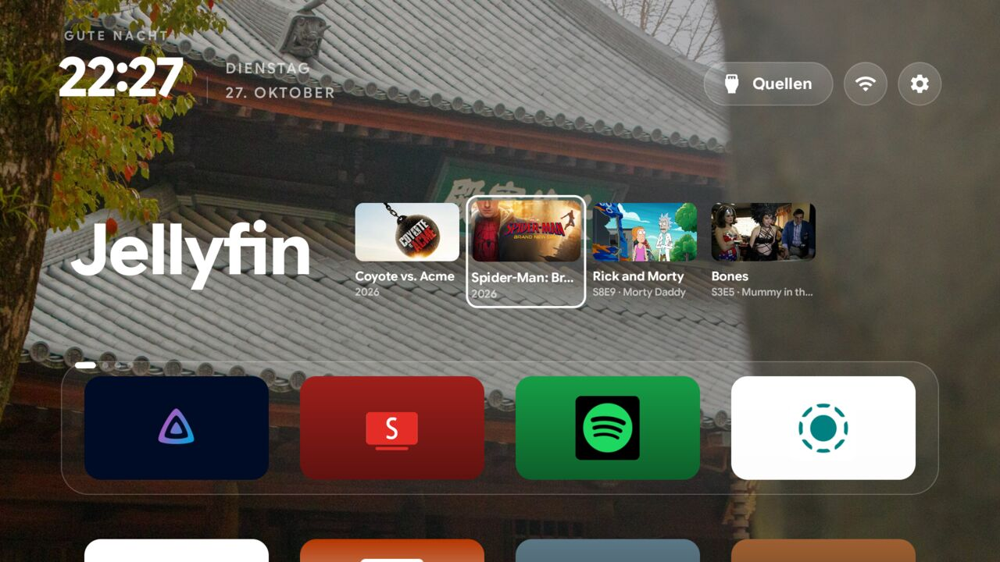

# engawa

A fork of [cleanyourtv](https://github.com/Gathin23/cleanyourtv) that puts a row of recent titles beside the focused dock
app's name, built and used on one SHARP 55GP6260E (Sharp Google TV, Android 11). Engawa is the veranda that wraps a
Japanese temple; the look was tuned around a photo of one. It is the reference launcher (`com.gathin.tvhome`, MIT) with
a different typeface and three feed rows added, so everything upstream does still works.

Select an app on the dock and its row appears to the right of its name. **Up** from the dock enters the cards, **Left** and
**Right** walk along them, **Down** returns to the dock, **Up** again reaches the top bar, and **OK** opens the card.

| Row | What it shows | OK on a card |
|---|---|---|
| Jellyfin | What you are watching now, then what you watched last (movies, and one card per series) | Opens Jellyfin |
| SmartTube | The newest upload of each YouTube subscription (the API has no watch history) | Plays that video in SmartTube |
| Spotify | What you last played from (a playlist, album or artist, DJ included), Liked Songs always second, then your playlists | Opens Spotify and starts that list playing, Liked Songs included |
| LocalSend and the grid | Nothing | Unchanged |

Also: Google Sans Flex (SIL OFL 1.1, trimmed to the weight axis and Latin, 133 KB) instead of Outfit, with a heavier weight
scale: the clock and app names at 700, the other text a step or two heavier than upstream. The dock apps and remote-button
mappings in `config.xml` are the author's (Jellyfin, SmartTube, Spotify, LocalSend); change them there or with a theme.

## Network and permissions

Upstream's launcher has no network access. **This one does**: `INTERNET`, and plain HTTP allowed (`usesCleartextTraffic`)
for a Jellyfin server on the home network. It talks to nothing else than:

| Host | Why |
|---|---|
| your Jellyfin server | the Jellyfin row |
| `api.spotify.com`, `accounts.spotify.com`, album and playlist covers on Spotify's CDN | the Spotify row |
| `www.googleapis.com`, `oauth2.googleapis.com`, `i.ytimg.com` | the SmartTube row |

No analytics, no telemetry, no other servers. Access and refresh tokens are kept in the launcher's private preferences
(`SharedPreferences "feeds"`); clear the app's data to sign out. A row you never link makes no request.

## Setting it up

Spotify and YouTube cannot sign in on a TV, so tokens are made on a computer and pushed once:

1. **Spotify**: a free app at developer.spotify.com (Web API), redirect URI `http://127.0.0.1:8888/callback`.
   `python3 -I launcher/feeds-auth/spotify_auth.py <client id> spotify.json`, then open the link it prints.
2. **YouTube**: a Google Cloud OAuth client of type "TVs and Limited Input devices" with the YouTube Data API enabled and the
   consent screen published (in Testing mode the token expires after 7 days).
   `python3 -I launcher/feeds-auth/youtube_auth.py <client id> <client secret> youtube.json`, then enter the code at google.com/device.
3. **Jellyfin** signs in on the TV with Quick Connect: a code appears beside the name, you enter it in any Jellyfin app.
4. Put the first two in one `feeds.json`: `{"spotify": {...}, "youtube": {...}, "jellyfin": {"server": "http://host:8096"}}`
   and copy it to `/sdcard/Android/data/com.gathin.tvhome/files/feeds.json`. The launcher reads it into its private storage
   and deletes it. The helper scripts write their files with mode 600; delete them afterwards.
5. Build and install as upstream does (`launcher/build-and-install.sh`, JDK 17, Android SDK 34).

## Things to know

- It will not be merged upstream: network access and sign-in tokens are against that project's rules (see its `AGENTS.md`).
- Upstream changes are not picked up automatically; rebase this branch onto `main` yourself.
- The wallpaper and theme in the screenshot are the author's and are not in this branch.

Tested on: SHARP 55GP6260E (Sharp Google TV, MediaTek MTK9612, 1 GB), Google TV, Android 11. One unit, in a single long
session (a few hours); not lived with for days. The release APK is about 555 KB (upstream's gate is 576 KB).

Licence: MIT (CleanYourTV) for the code; `launcher/FONT-LICENSE-GOOGLE-SANS-FLEX-OFL.txt` and
`launcher/FONT-LICENSE-OFL.txt` for the fonts.
